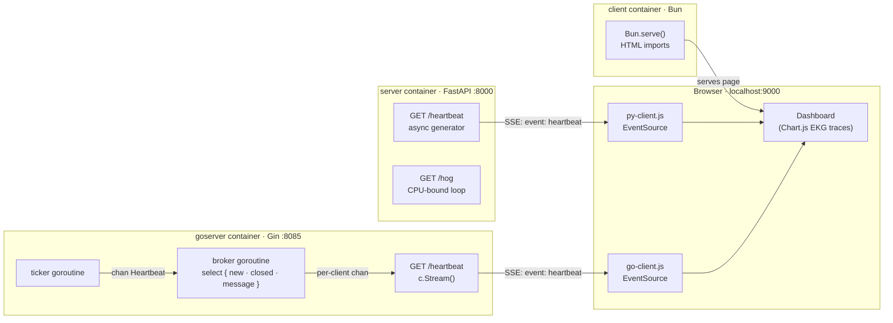

# Engineering notes

Design details and debugging lessons behind [Goncurrenpy](../README.md).

## Architecture



### The Go SSE broker

```
ticker goroutine ──► stream.Message ──┐
HTTP handler     ──► NewClients     ──┼──► listen() goroutine ──► fan-out to every client chan
CloseNotify      ──► ClosedClients  ──┘      (owns the client map; no locks)
```

Each `/heartbeat` request registers its own buffered channel with the broker, then blocks in `c.Stream()`, writing an SSE frame for every message it receives. When the browser disconnects, the client is unregistered and its channel is closed. The broadcast never blocks: a client that isn't ready doesn't stall the others.

### The liveness watchdog (client)

Each chart records `lastBeatAt` whenever a heartbeat arrives. On every 10 ms render tick it checks:

```js
const alive = performance.now() - lastBeatAt < SERVER_INTERVAL_MS * 1.5;
```

If the server misses a beat by more than the grace period, the trace goes flat.

## Debugging lessons

- **Stale-timer race in the client.** The first version did `flag = true; setTimeout(() => flag = false, 10s)` on every event and never cancelled the timers. When the timeout equals (or is a multiple of) the server's send interval, an old timer and a new event fire at almost the same moment. Their order depends on network jitter and main-thread load, so the trace randomly went flat for a whole interval. **Fix:** a single `lastBeatAt` timestamp compared against a grace period.
- **`await asyncio.sleep()` doesn't block, but CPU work does.** A hog made of a short computation followed by `await asyncio.sleep(10)` blocked the event loop for only about 1 s, so the heartbeat never missed a beat. A real stall needs CPU-bound code that runs for a long time without awaiting.
- **`EventSource` reconnects automatically.** When an SSE response ends, the browser reconnects after the server's `retry:` delay. For a one-shot endpoint like `/hog`, that silently re-runs the hog in a loop. The client now closes the source once it gets the result or an error.
- **Non-blocking fan-out can drop messages.** `select { case ch <- msg: default: }` keeps a slow client from stalling the others. With unbuffered per-client channels, though, a message that arrives while the handler is still flushing is lost. A buffer of 1 closes that window.
- **Synced source is not a rebuilt binary.** Compose `sync` copies files into a container, but a compiled Go service needs `action: rebuild`. Restarting the container alone keeps the old binary.

## Roadmap

- [ ] Go `/hog` endpoint (CPU-bound goroutine) and its client handler
- [ ] Scenario 2: `GOMAXPROCS=1` to show Go's preemptive scheduler on a single core
- [ ] Scenario 3: 100k idle goroutines vs. 100k idle coroutines
- [ ] Python variants: `asyncio.to_thread` / `ProcessPoolExecutor` to offload CPU work
- [ ] Wire up the dashboard's scenario buttons and status panels
- [ ] Measure heartbeat jitter in numbers, alongside the visual trace
